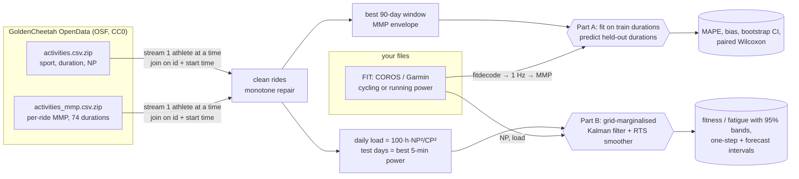
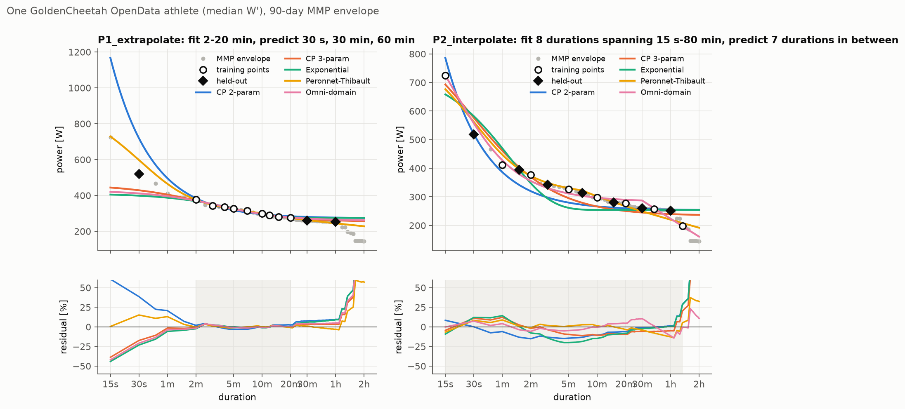
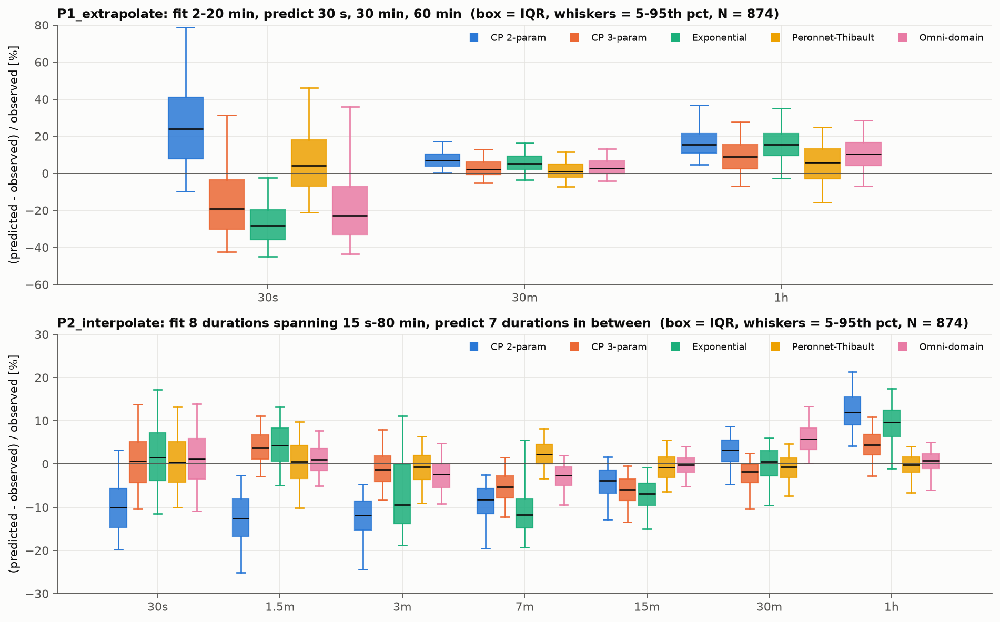
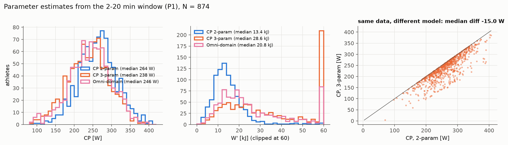
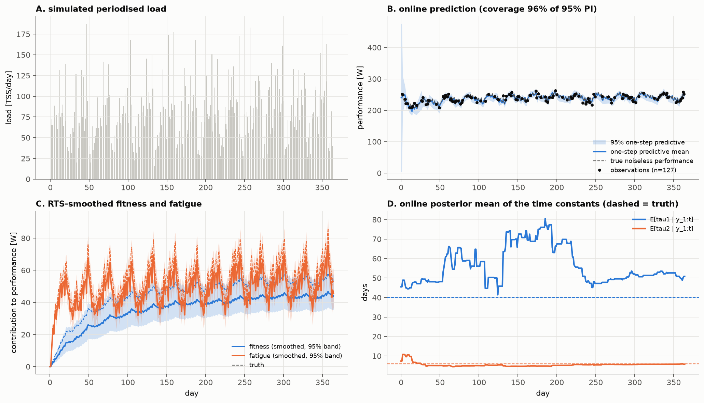
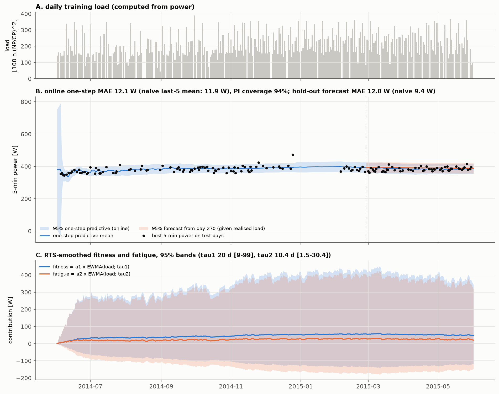

# pdcurve — which power-duration model actually predicts? An out-of-sample benchmark on 874 real athletes, plus a Kalman-filter fitness-fatigue model

[](.github/workflows/ci.yml) [](LICENSE) [-lightgrey)](https://doi.org/10.17605/OSF.IO/6HFPZ)

Power-duration models are usually judged by how well they fit the points they were fitted to.
That is the wrong question. A coach or an athlete uses CP, W′ and friends to **predict efforts they
have not done**: the 60-minute power from a 3–12 minute test, or the 30-second power from the same
test. This repo asks that question on public data:

* **(A)** five classic models, two prediction protocols, **874 cyclists** from GoldenCheetah OpenData,
  errors reported as distributions across athletes with bootstrap CIs and paired tests;
* **(B)** the Banister impulse-response model rewritten as a **linear-Gaussian state-space model**,
  so a Kalman filter updates fitness, fatigue and the model's own parameters **online, with
  uncertainty**, and gives honest prediction intervals. Validated by simulation (parameter
  recovery + interval calibration over 100 replicates) and run on one real athlete-season.

It also works on your own files: `pdcurve fit *.fit` reads COROS / Garmin / Wahoo FIT files
(cycling or running power) and fits every model.

## TL;DR

| pooled out-of-sample MAPE (%) | CP 2-param | CP 3-param | Exponential | Peronnet–Thibault | Omni-domain |
|---|---|---|---|---|---|
| **P1** fit 2–20 min → predict 30 s, 30 min, 60 min | 18.6 | 13.2 | 17.4 | **10.6** | 14.4 |
| **P2** fit 8 points 15 s–80 min → predict 7 in-between durations | 9.7 | 5.1 | 8.0 | **3.7** | 4.0 |

* With a classic **2–20 min testing window**, *every* model is mediocre outside that window. The
  2-parameter CP model over-predicts 60-min power by **+17.6 %** on average (it has no notion of
  fatigue beyond CP) and 30-s power by +28 %. Peronnet–Thibault is best here mostly because its
  long-duration log-decline is identifiable from 7–20 min data; the omni-domain model's decline
  only starts at 30 min, so from 2–20 min it is literally not estimable (we fix it to 0, see below).
* "CP" is **not a model-free physiological constant**: on identical data, the 3-parameter model
  gives a CP that is a median **15 W lower** than the 2-parameter model, and W′ roughly doubles.
* Given points spread over the whole curve, Peronnet–Thibault and the omni-domain model interpolate
  to within **~3–4 %**; CP2 cannot (it is structurally wrong at both ends).
* The Kalman fitness-fatigue model recovers simulated Banister parameters with **calibrated
  intervals (92–96 % coverage of nominal 95 % over 100 replicates)**. On a real season its
  one-step error (11.6–12.1 W) is about the same as a naive "mean of the last 5 tests"
  (11.9 W), its 95-day forecast is worse (12.0 vs 9.4 W), and the fitness and fatigue gains are not
  distinguishable from zero. The intervals are still calibrated (94–98 %).
  See [Part B](#b-fitness-fatigue-as-a-state-space-model).

## Why I built this

<!-- TODO(Tommaso): dictate 3-4 lines in your own words -->

## Pipeline



## Data

* **Source:** GoldenCheetah OpenData Project, Liversedge (2018), OSF project `6hfpz`,
  DOI [10.17605/OSF.IO/6HFPZ](https://doi.org/10.17605/OSF.IO/6HFPZ) (DataCite).
* **License:** CC0 1.0 (verified on the OSF node and on the DataCite record). Data are anonymised
  by the project; we use only an athlete UUID.
* **What we download:** the full archive is ~6,600 athlete zips, **~116 GB**. We do not touch it.
  The project's `INDEX/` folder publishes per-activity summaries, and two of them are all we need:
  `activities.csv.zip` (55.1 MB) and `activities_mmp.csv.zip` (24.2 MB) → **79.3 MB in total**
  (sizes + SHA-256 in [`results/dataset_manifest.json`](results/dataset_manifest.json)). The index
  covers 1,150 athletes / 642,733 activities.
* **Streaming:** both files are grouped by athlete; the bike-activity metadata goes into an on-disk
  SQLite index and the MMP file is streamed one athlete at a time (peak RSS ≈ 110 MB).

**Cleaning and selection** (all in [`src/pdcurve/opendata.py`](src/pdcurve/opendata.py)):

1. keep `sport == "Bike"` with a recorded Normalized Power; 295,525 rides;
2. drop rides with a 1-s value > 2500 W or 15-s value > 2000 W (power-meter spikes);
3. **monotone repair** of each ride's curve: a valid MMP curve is non-increasing (any window of
   length $t_2$ contains a sub-window of length $t_1<t_2$ with at least the same mean), so we set
   $\tilde P(t)=\max_{t'\ge t}P(t')$;
4. per athlete, choose the **90-day window with the most rides** (≥ 10) and take the upper envelope
   of all rides in it: one curve per athlete, so athletes are independent units;
5. require finite values at every duration used by either protocol (15 s … 80 min), 20-min power in
   [60, 550] W and 15-s / 20-min ratio ≤ 6.

| athletes in index | no bike power | < 10 rides | no dense window | envelope incomplete | implausible | **kept** |
|---|---|---|---|---|---|---|
| 1,114 with MMP rows | 90 | 99 | 19 | 26 | 6 | **874** |

Median 57 rides per 90-day window (IQR 38–75). The derived envelopes are committed
([`data/derived/envelopes.csv`](data/derived/envelopes.csv), 380 kB) so Part A reruns without any download.

## A. Power-duration models

All models give maximal mean power $P$ [W] as a function of duration $t$ [s].

**2-parameter critical power** (Monod & Scherrer 1965) — a hyperbola, i.e. work is linear in time:

$$P(t)=\mathrm{CP}+\frac{W'}{t}$$

**3-parameter critical power** (Morton 1996) — adds a finite maximal power $P_{\max}$ at $t\to 0$.
Morton writes $t=\frac{W'}{P-\mathrm{CP}}-\frac{W'}{P_{\max}-\mathrm{CP}}$; solved for $P$:

$$P(t)=\mathrm{CP}+\frac{W'}{t+k},\qquad k=\frac{W'}{P_{\max}-\mathrm{CP}}$$

**Exponential** — decay from $P_0$ to an asymptote, the form compared by Hopkins et al. (1989):

$$P(t)=\mathrm{CP}+(P_0-\mathrm{CP})\,e^{-t/\tau}$$

**Peronnet–Thibault** (1989), in mechanical-power form. Aerobic power rises with on-kinetics
$k_1$, anaerobic capacity $S$ is released with time constant $k_2$, and beyond $T_{\mathrm{MAP}}$
both decline logarithmically:

$$P(t)=f(t)\left[\mathrm{MAP}\left(1-\frac{k_1}{t}\left(1-e^{-t/k_1}\right)\right)+\frac{S}{t}\left(1-e^{-t/k_2}\right)\right],\qquad
f(t)=\begin{cases}1 & t\le T_{\mathrm{MAP}}\\ 1-\frac{A}{\mathrm{MAP}}\ln\frac{t}{T_{\mathrm{MAP}}} & t>T_{\mathrm{MAP}}\end{cases}$$

with $k_1=30$ s, $k_2=20$ s, $T_{\mathrm{MAP}}=420$ s fixed (the published constants); free parameters
$S,\ \mathrm{MAP},\ A$. The basal-metabolic term of the original is dropped because we model
*mechanical* power.

**Omni-domain** (Puchowicz, Baker & Clarke 2020):

$$P(t)=\frac{W'}{t}\left(1-e^{-t\,(P_{\max}-\mathrm{CP})/W'}\right)+\mathrm{CP}-A\ln\!\left(\frac{t}{T_{\mathrm{CP}_{\max}}}\right)\mathbb{1}[t>T_{\mathrm{CP}_{\max}}],\qquad T_{\mathrm{CP}_{\max}}=1800\ \mathrm{s}$$

**Fitting.** Bounded nonlinear least squares (`scipy.optimize.least_squares`, TRF) on **relative**
residuals, multi-start, so the loss matches the evaluation metric:

$$\hat\theta=\arg\min_{\theta}\sum_{i\in\mathrm{train}}\left(\frac{P_\theta(t_i)-P_i}{P_i}\right)^2$$

**Identifiability rule.** If no training duration exceeds $T_{\mathrm{CP}_{\max}}$, the data contain
zero information about the omni-domain $A$; we fix $A=0$ and record it (`fixed` column of
[`results/fit_params.csv`](results/fit_params.csv)). Parameters that end on a bound are logged too
(e.g. CP3 $P_{\max}$ hits its 5000 W bound for 155/874 athletes under P1 — a sign that 2–20 min data
say nothing about sprint power).

### Protocols

| protocol | training durations | held-out durations |
|---|---|---|
| **P1 extrapolate** | 2, 3, 4, 5, 7, 10, 12, 15, 20 min | 30 s, 30 min, 60 min |
| **P2 interpolate** | 15 s, 1, 2, 5, 10, 20, 40, 80 min | 30 s, 90 s, 3, 7, 15, 30, 60 min |

Error for athlete $j$, model $m$, held-out duration $t$:
$e_{jmt}=\big(\hat P_{jm}(t)-P_j(t)\big)/P_j(t)$. We report MAPE $=\overline{|e|}$ with a 95 %
percentile bootstrap CI over athletes (2,000 resamples), and bias $=\bar e$ (positive = model
over-predicts).

### Results

N = 874 athletes. Cells: **MAPE % [95 % CI] / bias %**; best per row in bold. Full table with
median APE and 90th percentile: [`results/benchmark_table.csv`](results/benchmark_table.csv).

**P1 — fit 2–20 min, extrapolate**

| held-out | CP 2-param | CP 3-param | Exponential | Peronnet–Thibault | Omni-domain |
|---|---|---|---|---|---|
| 30 s | 30.3 [28.6–32.3] / +27.8 | 23.4 [22.4–24.3] / −13.9 | 27.5 [26.7–28.2] / −26.5 | **15.9 [14.9–17.0] / +6.8** | 25.8 [24.9–26.7] / −16.6 |
| 30 min | 7.8 [7.5–8.2] / +7.7 | 4.7 [4.4–5.0] / +3.0 | 6.8 [6.5–7.2] / +5.9 | **4.7 [4.4–5.0] / +1.7** | 4.9 [4.6–5.2] / +3.5 |
| 60 min | 17.6 [16.8–18.4] / +17.6 | 11.6 [10.9–12.4] / +9.7 | 17.8 [17.0–18.8] / +15.8 | **11.2 [10.5–12.0] / +5.3** | 12.6 [11.9–13.4] / +10.8 |
| pooled | 18.6 [17.9–19.4] / +17.7 | 13.2 [12.7–13.8] / −0.4 | 17.4 [16.9–17.9] / −1.6 | **10.6 [10.2–11.1] / +4.6** | 14.4 [13.9–15.0] / −0.8 |

**P2 — fit across the curve, interpolate**

| held-out | CP 2-param | CP 3-param | Exponential | Peronnet–Thibault | Omni-domain |
|---|---|---|---|---|---|
| 30 s | 10.4 [10.1–10.8] / −9.5 | 5.8 [5.5–6.2] / +0.8 | 7.1 [6.7–7.5] / +1.7 | **5.6 [5.3–5.9] / +0.8** | 5.9 [5.6–6.2] / +1.3 |
| 90 s | 13.3 [12.8–13.8] / −13.2 | 4.8 [4.5–5.0] / +4.0 | 5.8 [5.5–6.0] / +4.3 | 4.9 [4.6–5.2] / +0.2 | **3.1 [3.0–3.3] / +1.1** |
| 3 min | 12.9 [12.4–13.4] / −12.9 | 3.9 [3.7–4.2] / −1.0 | 10.3 [9.9–10.7] / −6.8 | **3.6 [3.4–3.9] / −1.0** | 4.0 [3.8–4.2] / −2.6 |
| 7 min | 9.4 [9.0–9.8] / −9.4 | 5.9 [5.6–6.1] / −5.3 | 11.8 [11.5–12.1] / −10.6 | **3.4 [3.2–3.6] / +2.3** | 3.6 [3.5–3.8] / −2.9 |
| 15 min | 5.1 [4.8–5.5] / −4.7 | 6.3 [6.1–6.6] / −6.2 | 7.4 [7.1–7.7] / −7.2 | 2.9 [2.8–3.1] / −0.6 | **2.2 [2.0–2.3] / −0.4** |
| 30 min | 4.4 [4.1–4.7] / +2.6 | 3.5 [3.3–3.8] / −2.6 | 3.8 [3.5–4.0] / −0.3 | **3.0 [2.9–3.3] / −1.0** | 6.2 [6.0–6.5] / +6.0 |
| 60 min | 12.6 [12.3–13.0] / +12.4 | 5.2 [5.0–5.5] / +4.2 | 9.9 [9.6–10.2] / +9.1 | **2.6 [2.4–2.8] / −0.5** | 2.8 [2.6–3.0] / +0.4 |
| pooled | 9.7 [9.6–9.9] / −5.0 | 5.1 [5.0–5.2] / −0.9 | 8.0 [7.8–8.1] / −1.4 | **3.7 [3.6–3.8] / +0.0** | 4.0 [3.9–4.1] / +0.4 |

**Paired tests** (per-athlete mean APE, Wilcoxon signed-rank, Holm-corrected,
[`results/paired_tests.md`](results/paired_tests.md)): Peronnet–Thibault beats every other model in
both protocols ($p<10^{-11}$). Under P2 its margin over the omni-domain model is small: median
paired difference **0.38 percentage points**, P–T better for 63 % of athletes. Under P1 it beats
the 3-parameter CP model for 73 % of athletes (median 3.4 pp).

Note the omni-domain model's **+6 % bias at exactly 30 min** under P2: its decline term switches on
at $t=1800$ s, so the fitted curve is flat right up to the point where the data have already
started to fall. That is a structural property of the piecewise form, visible in Fig. 1 (right).



*Fig. 1 — One athlete (median W′). Open circles: training points; black diamonds: held-out.
Bottom: relative residuals on the whole envelope; shaded = training span.*



*Fig. 2 — Signed out-of-sample error across 874 athletes (box = IQR, whiskers = 5th–95th percentile).*



*Fig. 3 — Parameters from the 2–20 min window. CP: CP2 median 264 W (IQR 228–292), CP3 238 W
(201–276), omni 246 W (208–280). W′: CP2 13.4 kJ (10.0–17.3), CP3 28.6 kJ (17.3–55.5). The right panel
is the point: CP depends on the model you choose.*

## B. Fitness-fatigue as a state-space model

### Model

Daily load $w_t$, performance $y_t$ observed only on some days. The two Banister impulse responses
are written as exponentially weighted *means* of past load (the CTL/ATL convention; load before
day $t$ only):

$$g_t=\phi_1 g_{t-1}+(1-\phi_1)\,w_{t-1},\qquad h_t=\phi_2 h_{t-1}+(1-\phi_2)\,w_{t-1},\qquad \phi_i=e^{-1/\tau_i}$$

The gains and baseline form the state, with an optional random walk:

$$\theta_t=\begin{bmatrix}p_{0,t}\\ a_{1,t}\\ a_{2,t}\end{bmatrix}=\theta_{t-1}+\eta_t,\quad \eta_t\sim\mathcal N(0,Q)$$

$$y_t=\underbrace{\begin{bmatrix}1 & g_t & -h_t\end{bmatrix}}_{H_t}\theta_t+\varepsilon_t,\quad \varepsilon_t\sim\mathcal N(0,\sigma^2)$$

Fitness and fatigue in performance units are $a_1 g_t$ and $a_2 h_t$. The classic Banister gains
are $k_i=a_i(1-\phi_i)$. Normalising by $(1-\phi_i)$ is not cosmetic: $g_t$ then has the same
scale (load/day) for every $\tau_1$, so one prior on $a_1$ means the same thing across the whole
$\tau$ grid. Without it, the marginal likelihood picks up a spurious $\tau$-dependent Occam factor.

**Conditional on $\psi=(\tau_1,\tau_2,\sigma)$ the model is linear-Gaussian.** The Kalman filter
(Kalman 1960) is then *exact*:

$$\text{predict: } m_{t|t-1}=m_{t-1},\quad P_{t|t-1}=P_{t-1}+Q$$

$$\text{update: } v_t=y_t-H_t m_{t|t-1},\quad F_t=H_tP_{t|t-1}H_t^\top+\sigma^2,\quad K_t=P_{t|t-1}H_t^\top F_t^{-1}$$

$$m_t=m_{t|t-1}+K_tv_t,\qquad P_t=P_{t|t-1}-K_tF_tK_t^\top$$

On days without a test, only the predict step runs. The prediction-error decomposition gives the
exact marginal likelihood, *online*:

$$\log p(y_{1:t}\mid\psi)=-\frac12\sum_{s\le t,\ y_s\ \mathrm{obs}}\left(\log 2\pi F_s+\frac{v_s^2}{F_s}\right)$$

**The nonlinear $\psi$ is integrated on a grid**: 30 × 30 × 24 geometric points in
$\tau_1\in[8,120]$ d, $\tau_2\in[1,30]$ d, $\sigma$ around the data's noise scale, restricted to
$\tau_1>\tau_2$ (≈19k filters run in parallel as one vectorised NumPy recursion). With a
log-uniform prior on the grid,
$p(\psi_g\mid y_{1:t})\propto p(y_{1:t}\mid\psi_g)$, and every predictive quantity is a finite
Gaussian mixture:

$$p(y_{t}\mid y_{1:t-1})=\sum_g w_{g,t-1}\ \mathcal N\!\left(H_t^{(g)}m^{(g)}_{t|t-1},\ F^{(g)}_t\right)$$

Intervals are exact mixture quantiles (vectorised bisection on the mixture CDF). Grid marginals of
$\tau_1,\tau_2,\sigma$ are turned into intervals by treating each grid value as a log-space cell.
Fitness/fatigue trajectories come from a **Rauch–Tung–Striebel smoother** (Rauch, Tung & Striebel
1965) run on the grid points carrying 99.9 % of the posterior mass:

$$C_t=P_tP_{t+1|t}^{-1},\quad m_t^s=m_t+C_t(m_{t+1}^s-m_{t+1|t}),\quad P_t^s=P_t+C_t(P_{t+1}^s-P_{t+1|t})C_t^\top$$

Forecasts for a planned load add $hQ$ to the state covariance and $\sigma^2$ to the observation.
With $Q=0$ the filter reduces to exact sequential Bayesian linear regression; the test-suite
checks that equivalence (posterior and marginal likelihood) to machine precision.

Default prior (weakly informative, data-scaled): $p_0\sim\mathcal N(\tilde y, (0.5\tilde y)^2)$,
$a_i\sim\mathcal N(0,(0.005\tilde y)^2)$ with $\tilde y$ the median performance.

Related work: Kolossa et al. (2017) used a Kalman filter as feedback for the fitness-fatigue
model; Busso (2003) made the gains time-varying via recursive least squares. The difference here
is that the time constants and the noise are **marginalised** rather than fixed, so the intervals
include uncertainty about $\tau_1,\tau_2,\sigma$.

### Validation on simulated data

Truth: $p_0=250$ W, $a_1=0.9$, $a_2=1.0$ W per (load/day), $\tau_1=40$ d, $\tau_2=6$ d,
$\sigma=5$ W; 365 days of periodised load (3:1 build/recovery, rest days, progressive overload);
a test on each day with probability 0.35 (≈128 tests). Static parameters ($Q=0$).

**One replicate** (Fig. 4): every one of the 8 quantities has its truth inside the 95 % interval,
and 96 % of observations fall inside the one-step-ahead 95 % predictive interval. Panel D shows
the honest part: $\tau_2$ locks in within ~40 days, $\tau_1$ wanders between 45 and 80 d for half
a season before settling at 50 d [36–71] — long time constants are weakly identified by design.

**Calibration over 100 independent replicates** ([`results/kalman_sim.json`](results/kalman_sim.json)):

| | $p_0$ | $a_1$ | $a_2$ | $k_1$ | $k_2$ | $\tau_1$ | $\tau_2$ | $\sigma$ |
|---|---|---|---|---|---|---|---|---|
| coverage of 95 % interval | 0.93 | 0.94 | 0.92 | 0.95 | 0.96 | 0.96 | 0.94 | 0.96 |
| median \|relative error\| of posterior median | 0.8 % | 8.8 % | 7.5 % | 16 % | 3.6 % | 9.6 % | 7.5 % | 3.5 % |

Mean coverage of the one-step 95 % predictive interval: **95.3 %**. With 100 replicates the Monte
Carlo standard error of a coverage near 0.95 is ≈ 0.02, so all eight are consistent with nominal.
(A first version with a coarser grid and point-mass grid quantiles gave 0.57 coverage for $\sigma$
and 0.72 for $\tau_2$: intervals collapsed onto single grid points. Treating grid values as
log-space cells and refining the grid fixed it.)



*Fig. 4 — Simulation. B: online one-step predictive mean and 95 % band vs noisy tests and the true
curve. C: smoothed fitness/fatigue (solid, 95 % band) vs truth (dashed). D: online posterior means of
the time constants.*

### One real athlete-season

Athlete `068a26b7…` (CC0 OpenData), 365 days from 2014-06-02, 316 riding days, chosen by the
rule in [`scripts/05a_select_demo_athlete.py`](scripts/05a_select_demo_athlete.py) (most test days).
Load $=100\cdot\text{hours}\cdot(\mathrm{NP}/\mathrm{CP})^2$ with CP = 364 W from the athlete's
2–20 min envelope (GoldenCheetah's own IF implies a threshold of ≈360 W, so the scale agrees;
this is a high-volume rider, often 2–3 rides and 200–350 load units a day). Performance = best
5-min power on 153 "test days" (≥ 90 % of the trailing 42-day best). The season is committed as
[`data/demo/athlete_season.csv`](data/demo/athlete_season.csv).

| one-step-ahead, days 30–365 (135 tests) | MAE [W] | 95 % PI coverage |
|---|---|---|
| Kalman, static parameters | 12.1 | 94 % |
| Kalman, $p_0$ random walk (1 W/day) | **11.6** | 95 % |
| naive: last test | 15.8 | – |
| naive: mean of last 5 tests | 11.9 | – |

| hold-out: filter days 1–270, forecast days 271–365 (54 tests) | MAE [W] | 95 % PI coverage |
|---|---|---|
| Kalman forecast given the realised load | 12.0 | 98 % |
| naive: mean of last 5 training tests | **9.4** | – |

Posterior ([`results/kalman_real.json`](results/kalman_real.json)): $\sigma=15.0$ W [13.3–16.8],
$\tau_1=20$ d [9–99], $\tau_2=10$ d [1.5–30], and the 95 % intervals of both gains $a_1,a_2$
**include zero**. Read plainly: in this season the data cannot tell fitness from fatigue. The
intervals are calibrated (94–98 % coverage), but the point predictions are no better than a
5-test moving average, and the 95-day forecast is worse. The filter says "I don't know" with the
right width, which is the most you should ask of Banister on field data; Fig. 5C's enormous bands
are the result, not a plotting bug.



*Fig. 5 — Real athlete-season. B: online one-step 95 % band (blue) and the hold-out forecast from
day 270 (orange). C: smoothed fitness and fatigue with 95 % bands. The bands are huge because the
gains are not identified.*

## Use it on your own FIT files

```bash
python -m venv .venv && source .venv/bin/activate
pip install -e .

# MMP envelope of a block of training (any number of FIT files)
pdcurve mmp rides/*.fit > my_mmp.csv

# fit every model on the 2-20 min part of the envelope, with a figure
pdcurve fit rides/*.fit --min-s 120 --max-s 1200 --plot my_fit.png
# ...or on an existing curve
pdcurve fit --mmp-csv my_mmp.csv --models cp3,pt,omni --min-s 15 --max-s 3600

# daily load with your CP as threshold, then the Kalman fitness-fatigue model
pdcurve load rides/*.fit --cp 265 > load.csv          # date,load
# add a "perf" column (e.g. best 5-min power on test days), then:
pdcurve banister season.csv --forecast-days 14 --plot ff.png
```

FIT parsing uses [`fitdecode`](https://github.com/polyvertex/fitdecode): the native `power` field
first, otherwise a developer field whose name contains "power" (Stryd and similar). Samples are put
on a 1 Hz grid; gaps ≤ 10 s are interpolated, longer gaps count as stopped (0 W). Running power
from COROS/Stryd works the same way, but the models were benchmarked on cycling only.

## Reproduce

```bash
pip install -e ".[dev]"
pytest -q                      # 26 synthetic tests, no network
bash scripts/reproduce.sh      # downloads 79 MB, ~10 min on a laptop, single process
```

| script | does | output |
|---|---|---|
| `00_download_opendata.py` | downloads the two index files, checks size, records SHA-256 | `data/raw/`, `results/dataset_manifest.json` |
| `01_prepare.py` | streams athletes one at a time → envelopes + daily series | `data/derived/` |
| `02_benchmark.py` | P1 + P2 for every athlete and model | `results/benchmark_table.*`, `per_athlete_errors.csv`, `fit_params.csv` |
| `03_figures_benchmark.py` | Figs 1–3, paired tests | `figures/`, `results/paired_tests.md` |
| `04_kalman_sim.py` | parameter recovery + 100-replicate calibration | `results/kalman_sim.json`, Fig. 4 |
| `05a_select_demo_athlete.py` | picks the athlete-season (rule in docstring) | `data/demo/athlete_season.csv` |
| `05_kalman_real.py` | online + hold-out evaluation on real data | `results/kalman_real.json`, Fig. 5 |

CI (GitHub Actions) runs the tests, a CLI smoke test, and re-runs the full benchmark from the
committed envelopes, checking every MAPE against the committed table (|Δ| < 0.2 pp). No downloads.

**Tests** (`tests/`): exact parameter recovery for each of the five models from noiseless curves
(rtol 1e-5) and approximate recovery from noisy ones; the omni-domain identifiability rule;
MMP vs brute force; NP/load identities; a FIT round-trip through a minimal FIT encoder written for
the tests (CRC included) and CLI recovery of CP from it; Kalman = exact Bayesian regression and
exact marginal likelihood; Banister parameter recovery inside 95 % intervals; one-step interval
calibration; static smoother = final filter.

## Limitations

* **MMP envelopes are not maximal tests.** CP models assume exhaustive efforts; a 90-day envelope
  of training rides is only an approximation, and its long end (60–80 min) is often a ride that
  was not ridden all-out. Part of the "error" at 60 min is the *data* being submaximal.
  The benchmark measures how well models predict *training-derived* MMP, which is what apps do.
* **One window per athlete, one sport.** Cycling only (`sport == "Bike"`); the OpenData index is
  a snapshot of 1,150 of ~6,600 athletes and is not a random sample of cyclists.
* **Model forms as implemented.** Peronnet–Thibault is used in mechanical-power form without the BMR
  term and with the published $k_1, k_2, T_{\mathrm{MAP}}$ fixed; the exponential form is one of
  several in the literature. I could verify the citations' metadata on Crossref but not re-read
  every original derivation, so treat these as faithful-in-spirit implementations.
* **P–T has an advantage in P1** because its decline starts at 7 min (inside the training window),
  while the omni-domain decline starts at 30 min (outside it) and is therefore fixed to 0. That is
  a real property of the models given this protocol, not a verdict on omni-domain in general.
* **Banister on field data is weakly identified.** Gains and time constants trade off; intervals
  are wide on purpose. Performance is a *proxy* (best 5-min power on days ≥ 90 % of the trailing
  42-day best), load is a TSS-like number with a single CP for the whole season, and the
  Gaussian/linear assumptions are approximations. One athlete-season is a demonstration, not
  evidence.
* **Grid integration** is exact only up to grid resolution; intervals for very sharply identified
  hyper-parameters are limited by the cell width.

## References (DOIs verified on Crossref, dataset on DataCite)

* Monod H, Scherrer J (1965). The work capacity of a synergic muscular group. *Ergonomics* 8(3):329–338. [10.1080/00140136508930810](https://doi.org/10.1080/00140136508930810)
* Morton RH (1996). A 3-parameter critical power model. *Ergonomics* 39(4):611–619. [10.1080/00140139608964484](https://doi.org/10.1080/00140139608964484)
* Hopkins WG, Edmond IM, Hamilton BH, Macfarlane DJ, Ross BH (1989). Relation between power and endurance for treadmill running of short duration. *Ergonomics* 32(12):1565–1571. [10.1080/00140138908966925](https://doi.org/10.1080/00140138908966925)
* Peronnet F, Thibault G (1989). Mathematical analysis of running performance and world running records. *J Appl Physiol* 67(1):453–465. [10.1152/jappl.1989.67.1.453](https://doi.org/10.1152/jappl.1989.67.1.453)
* Puchowicz MJ, Baker J, Clarke DC (2020). Development and field validation of an omni-domain power-duration model. *J Sports Sci* 38(7):801–813. [10.1080/02640414.2020.1735609](https://doi.org/10.1080/02640414.2020.1735609)
* Calvert TW, Banister EW, Savage MV, Bach T (1976). A systems model of the effects of training on physical performance. *IEEE Trans Syst Man Cybern* SMC-6(2):94–102. [10.1109/TSMC.1976.5409179](https://doi.org/10.1109/TSMC.1976.5409179)
* Busso T (2003). Variable dose-response relationship between exercise training and performance. *Med Sci Sports Exerc* 35(7):1188–1195. [10.1249/01.MSS.0000074465.13621.37](https://doi.org/10.1249/01.MSS.0000074465.13621.37)
* Clarke DC, Skiba PF (2013). Rationale and resources for teaching the mathematical modeling of athletic training and performance. *Adv Physiol Educ* 37(2):134–152. [10.1152/advan.00078.2011](https://doi.org/10.1152/advan.00078.2011)
* Kolossa D, Bin Azhar MA, Rasche C, Endler S, Hanakam F, Ferrauti A, Pfeiffer M (2017). Performance estimation using the fitness-fatigue model with Kalman filter feedback. *Int J Comput Sci Sport* 16(2):117–129. [10.1515/ijcss-2017-0010](https://doi.org/10.1515/ijcss-2017-0010)
* Kalman RE (1960). A new approach to linear filtering and prediction problems. *J Basic Eng* 82(1):35–45. [10.1115/1.3662552](https://doi.org/10.1115/1.3662552)
* Rauch HE, Tung F, Striebel CT (1965). Maximum likelihood estimates of linear dynamic systems. *AIAA J* 3(8):1445–1450. [10.2514/3.3166](https://doi.org/10.2514/3.3166)
* Liversedge M (2018). GoldenCheetah OpenData Project. OSF. [10.17605/OSF.IO/6HFPZ](https://doi.org/10.17605/OSF.IO/6HFPZ) — CC0 1.0.

Normalized Power and the TSS formula follow Allen & Coggan, *Training and Racing with a Power Meter* (book, no DOI).

## License

Code: MIT, © 2026 Tommaso Maggiolo. Data: GoldenCheetah OpenData is CC0; derived files in
`data/` inherit no additional restrictions. No personal data of the author is included.
